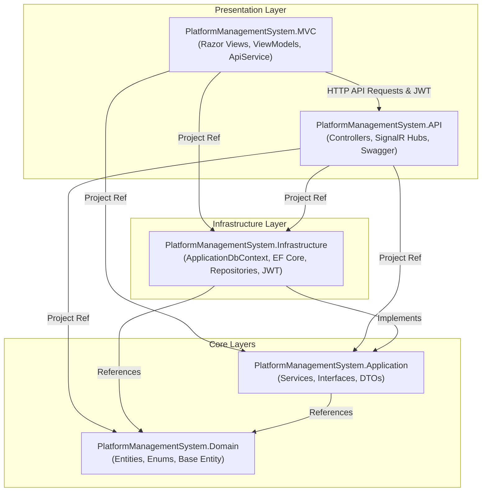
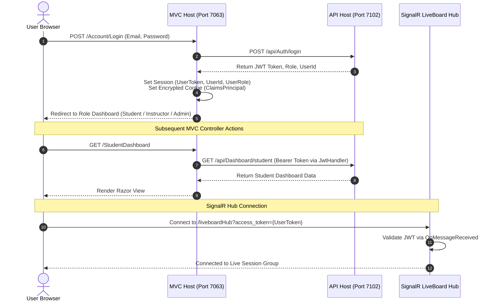

# PlatformManagementSystem (PMS)

[](https://dotnet.microsoft.com/)
[](https://learn.microsoft.com/aspnet/core)
[-512BD4?style=flat)](https://learn.microsoft.com/ef/core)
[](https://learn.microsoft.com/aspnet/core/signalr)
[](#architecture-and-project-structure)

**PlatformManagementSystem** is an enterprise-grade, multi-role E-Learning and Course Management platform built on **.NET 8**. The solution decouples business logic, persistence, and presentation using **Clean Architecture principles**. It features an **ASP.NET Core Web API** backend powering RESTful interactions and **SignalR** real-time hubs, coupled with a server-rendered **ASP.NET Core MVC** client that integrates interactive digital whiteboards and role-based workflows.

---

## Table of Contents

- [Business Purpose & Key Features](#business-purpose--key-features)
- [Architecture & Project Structure](#architecture--project-structure)
- [Technology Stack](#technology-stack)
- [Prerequisites & Software Requirements](#prerequisites--software-requirements)
- [Installation & Setup](#installation--setup)
- [Database Setup & Migrations](#database-setup--migrations)
- [Running the Application](#running-the-application)
- [Authentication & Authorization](#authentication--authorization)
- [Real-Time Capabilities & SignalR](#real-time-capabilities--signalr)
- [API Overview & Documentation](#api-overview--documentation)
- [Configuration & Environment Variables](#configuration--environment-variables)
- [Common Troubleshooting](#common-troubleshooting)
- [Security Considerations](#security-considerations)
- [Documentation Index](#documentation-index)
- [Contributing](#contributing)

---

## Business Purpose & Key Features

PlatformManagementSystem connects students, instructors, and administrators within a unified learning portal:

### 1. Student Portal
- **Course Discovery & Enrollment**: Browse course catalogs with category filtering, view syllabi, and enroll in courses.
- **Learning & Progress Tracking**: Step through curriculum lessons with persistent progress completion tracking.
- **Automated Examination**: Complete multiple-choice exams against real-time timers, submit answers, and receive instant automated grading.
- **Student Dashboard**: Visual metrics tracking enrolled courses, overall completion percentages, and exam performance histories.
- **Live Classroom & Whiteboard**: Join live sessions hosted by instructors and interact through an interactive whiteboard canvas.
- **Certification**: View course completion certificates upon achieving 100% course milestone completion.

### 2. Instructor Portal
- **Course Authoring**: Create and publish comprehensive courses with title, category, description, price, and thumbnail assets.
- **Curriculum Management**: Add and sequence structured lessons for enrolled students.
- **Exam Builder**: Design exams with configured duration windows and multiple-choice question pools with automated grading keys.
- **Student Performance Auditing**: Inspect enrollment lists and track student completion percentages in real time.
- **Live Virtual Classrooms**: Schedule, start, and end live lecture sessions with an integrated collaborative HTML5 canvas whiteboard (freehand sketch, geometric primitives, color controls, undo/redo, clear, and image export).

### 3. Administrator Dashboard
- **Platform Analytics**: Monitor platform-wide metrics including total registered users, active courses, total enrollments, and exams.
- **Identity & Access Management (IAM)**: Audit registered users, assign or revoke security roles, and remove accounts.
- **Role Governance**: Create and manage custom Identity roles.
- **Catalog Governance**: Oversee course listings and manage learning categories across the system.

---

## Architecture & Project Structure

The solution adheres to **Clean / Onion Architecture**, ensuring high cohesion, loose coupling, and strict dependency flow towards the domain core.



### Main Modules & Responsibilities

```
PlatformManagementSystem/
├── PlatformManagementSystem.sln            # Visual Studio Solution File
├── PlatformManagementSystem.slnLaunch.user  # Multi-project startup profile (API + MVC)
├── nuget.config                            # NuGet package source configuration
│
├── PlatformManagementSystem.Domain/        # Domain Layer (Enterprise Core)
│   ├── Common/                             # Base entity primitives (BaseEntity with Id, timestamps)
│   ├── Entities/                           # Domain entities: User, Course, Lesson, Exam, LiveSession...
│   └── Enums/                              # RoleType (Admin, Instructor, Student), CourseStatus
│
├── PlatformManagementSystem.Application/   # Application Layer (Business Logic)
│   ├── DTOs/                               # Data Transfer Objects (Auth, Course, Exam, Dashboard)
│   ├── Interfaces/                         # Repository and UnitOfWork contracts
│   │   └── Services/                       # Service interfaces (IAuthService, ICourseService, etc.)
│   └── Services/                           # Business service implementations (DashboardService, ExamService...)
│
├── PlatformManagementSystem.Infrastructure/ # Infrastructure Layer (Data & External Services)
│   ├── DependencyInjection/                # Service registration extensions
│   ├── Identity/                           # IdentitySeeder (roles and initial admin seeding)
│   ├── Migrations/                         # EF Core SQL Server migration history
│   ├── Persistence/                        # ApplicationDbContext, entity mappings, delete behaviors
│   ├── Repositories/                       # GenericRepository<T> & UnitOfWork implementation
│   └── Services/                           # JwtService implementation
│
├── PlatformManagementSystem.API/           # Web API & Real-Time Host
│   ├── Controllers/                        # REST Controllers (Auth, Course, Exam, LiveSession, Admin...)
│   ├── Hubs/                               # SignalR Hubs (LiveBoardHub, LiveSessionHub)
│   ├── wwwroot/                            # Static assets and standalone liveboard demonstration client
│   └── Program.cs                          # API middleware pipeline, JWT authentication, CORS, Swagger
│
└── PlatformManagementSystem.MVC/           # Web Presentation Host (Frontend)
    ├── Controllers/                        # MVC Controllers (Account, Instructor, Student, Admin, Live...)
    ├── Filters/                            # Action filters (AuthorizeSessionAttribute)
    ├── Helpers/                            # JwtHandler (DelegatingHandler for Bearer injection), JwtHelper
    ├── Services/                           # ApiService (HTTP client wrapper calling API)
    ├── ViewModels/                         # Strongly-typed models for Razor views
    ├── Views/                              # Razor views organized by feature area and layouts
    ├── wwwroot/                            # Static scripts (whiteboard.js, api.js, ajax-setup.js), CSS, libs
    └── Program.cs                          # MVC pipeline, Cookie auth, Session, HttpClient configuration
```

For comprehensive architectural specifications and diagrams, see the [Architecture Guide](docs/architecture.md).

---

## Technology Stack

| Layer / Aspect | Technology | Details |
| :--- | :--- | :--- |
| **Framework Target** | .NET 8.0 (C# 12) | Modern LTS runtime across all projects |
| **Backend API** | ASP.NET Core Web API | RESTful controllers, Swagger / OpenAPI integration |
| **Frontend Web** | ASP.NET Core MVC | Server-rendered Razor views, ViewModels, partials |
| **Real-Time Communication** | ASP.NET Core SignalR | WebSockets / Long Polling with hub groups |
| **Data Persistence** | Entity Framework Core 8.0 | Code-First migrations with SQL Server |
| **Database Engine** | Microsoft SQL Server | Default configured for `(localdb)\MSSQLLocalDB` |
| **Identity & Security** | ASP.NET Core Identity | Cookie Auth on MVC, JWT Bearer on Web API |
| **Serialization** | System.Text.Json / Newtonsoft.Json | Clean serialization and DTO mapping |
| **Client-Side Libraries** | Bootstrap 5, jQuery, HTML5 Canvas | Responsive layout and interactive digital whiteboard |

---

## Prerequisites & Software Requirements

Before installing and running the project locally, verify that your environment has:

1. **.NET 8.0 SDK** (v8.0.100 or newer)
   - Verify with: `dotnet --version`
2. **Microsoft SQL Server / LocalDB**
   - Microsoft SQL Server 2019+ or SQL Server Express / LocalDB (`(localdb)\MSSQLLocalDB`).
3. **EF Core CLI Tools** (optional for manual migrations):
   - Verify with: `dotnet ef --version`
   - Install globally if missing: `dotnet tool install --global dotnet-ef`
4. **IDE / Editor**:
   - Visual Studio 2022 (v17.8+ with *.NET desktop development* and *ASP.NET and web development* workloads)
   - OR Visual Studio Code / JetBrains Rider.

---

## Installation & Setup

1. **Clone the repository**:
   ```powershell
   git clone <repository-url>
   cd PlatformManagementSystem/PlatformManagementSystem
   ```

2. **Restore NuGet dependencies**:
   ```powershell
   dotnet restore
   ```

3. **Verify Configuration**:
   Inspect the database connection string in `PlatformManagementSystem.API/appsettings.json`:
   ```json
   "ConnectionStrings": {
     "DefaultConnection": "Server=(localdb)\\MSSQLLocalDB;Database=PlatformManagementSystemDB;Trusted_Connection=True;TrustServerCertificate=True;"
   }
   ```
   *If using a standalone SQL Server instance, adjust `Server`, `User Id`, and `Password` accordingly.*

---

## Database Setup & Migrations

The repository maintains an up-to-date EF Core migration pipeline in `PlatformManagementSystem.Infrastructure`.

To create and populate the database schema:

```powershell
dotnet ef database update --project PlatformManagementSystem.Infrastructure --startup-project PlatformManagementSystem.API
```

### Automatic Seeding
When the API project starts up (`Program.cs`), `IdentitySeeder.SeedRolesAndAdminAsync` automatically executes:
- Seeds default identity roles: `Student`, `Instructor`.
- Seeds a default administrative account if not already present:
  - **Email**: `admin@test.com`
  - **Password**: `Admin@123`
  - **Assigned Role**: `Instructor`

> [!NOTE]
> The seed script assigns `admin@test.com` to the `Instructor` role upon creation. To access endpoints protected by `[Authorize(Roles = "Admin")]` (such as the Admin Dashboard), the `Admin` role must be created and assigned via the role management API or database. See [Setup Guide](docs/setup-guide.md) for details.

---

## Running the Application

Because PlatformManagementSystem uses a distributed presentation architecture (MVC frontend consuming the Web API), **both projects must run concurrently**.

### Option A: Visual Studio (Recommended)
1. Open `PlatformManagementSystem.sln` in Visual Studio 2022.
2. The solution includes a multi-project launch profile (`PlatformManagementSystem.slnLaunch.user`).
3. Set the startup projects to **Multiple Startup Projects**:
   - `PlatformManagementSystem.API` -> **Start**
   - `PlatformManagementSystem.MVC` -> **Start**
4. Press `F5` or `Ctrl + F5`.
5. Visual Studio will launch:
   - **Web API & Swagger**: `https://localhost:7102/swagger`
   - **MVC Portal**: `https://localhost:7063`

### Option B: .NET CLI (Two Terminals)

**Terminal 1 — Start the API:**
```powershell
dotnet run --project PlatformManagementSystem.API
```
*API will listen on `https://localhost:7102` and `http://localhost:5092`.*

**Terminal 2 — Start the MVC Frontend:**
```powershell
dotnet run --project PlatformManagementSystem.MVC
```
*MVC will listen on `https://localhost:7063` and `http://localhost:5176`.*

Open your browser to `https://localhost:7063` to access the application.

---

## Authentication & Authorization

The system implements a dual-layer security architecture tailored to decoupled web platforms:



1. **API Layer (JWT Bearer)**:
   - Validates symmetric HMAC-SHA256 tokens using configured `Issuer`, `Audience`, and `Key`.
   - Protects controllers using `[Authorize]` and role-based policies `[Authorize(Roles = "Instructor")]`, `[Authorize(Roles = "Student")]`, and `[Authorize(Roles = "Admin")]`.
2. **MVC Layer (Cookies + Session)**:
   - Authenticates users through `CookieAuthenticationDefaults`.
   - Stores the active JWT in server session state (`HttpContext.Session.SetString("UserToken", token)`).
   - Injects Bearer tokens automatically into outgoing HTTP calls to the API via `JwtHandler` (`DelegatingHandler`).
3. **SignalR WebSocket Authentication**:
   - Browser WebSockets cannot send standard HTTP authorization headers during handshakes.
   - The API extracts the token from the query string parameter `?access_token={token}` in `JwtBearerEvents.OnMessageReceived` when targeting `/liveboardHub` or `/liveSessionHub`.

---

## Real-Time Capabilities & SignalR

PlatformManagementSystem features built-in real-time collaboration:

- **`LiveBoardHub` (`/liveboardHub`)**:
  - `JoinSessionGroup(sessionId)`: Joins a session room identified by `session-{id}`.
  - `LeaveSessionGroup(sessionId)`: Leaves the session group.
  - `Draw(sessionId, drawData)`: Broadcasts canvas draw commands (`dot`, `freehand`, `rectangle`, `circle`, `line`, `arrow`, `text`, `clear`) to all connected participants in the session.
  - `SendMessage(sessionId, message)`: Sends real-time chat messages to attendees.
- **`LiveSessionHub` (`/liveSessionHub`)**:
  - `JoinCourseGroup(courseId)`: Enrolls participants in course notifications (`Course_{id}`).
  - Used by `LiveSessionController.Start` to broadcast real-time `SessionStarted` events.

---

## API Overview & Documentation

When running `PlatformManagementSystem.API` in the `Development` environment, interactive Swagger/OpenAPI documentation is available at:

```
https://localhost:7102/swagger
```

### Core API Route Summary

| Controller | Route | Method | Access | Description |
| :--- | :--- | :--- | :--- | :--- |
| **Auth** | `/api/Auth/login` | `POST` | Public | Authenticates user; returns JWT token, userId, and role |
| **Auth** | `/api/Auth/register` | `POST` | Public | Registers a new user with assigned role |
| **Course** | `/api/Course` | `GET` | Public | Retrieves all courses |
| **Course** | `/api/Course` | `POST` | Instructor | Creates a new course |
| **Course** | `/api/Course/ByInstructor/{id}` | `GET` | Instructor | Retrieves courses authored by a specific instructor |
| **Course** | `/api/Course/details/{id}` | `GET` | Public | Retrieves course details with lessons and student counts |
| **Lesson** | `/api/Lesson/course/{id}` | `GET` | Public | Retrieves lessons for a course |
| **Lesson** | `/api/Lesson` | `POST` | Instructor | Creates a lesson within a course |
| **Enrollment** | `/api/Enrollment/{courseId}` | `POST` | Student | Enrolls student into a course |
| **Enrollment** | `/api/Enrollment/my-courses` | `GET` | Student | Retrieves current student's enrolled courses |
| **Enrollment** | `/api/Enrollment/progress` | `PUT` | Student | Updates student's lesson completion progress |
| **Exam** | `/api/Exam/create` | `POST` | Instructor | Creates an exam for a course |
| **Exam** | `/api/Exam/AddQuestion` | `POST` | Instructor | Adds question and answers to an exam |
| **Exam** | `/api/Exam/{id}` | `GET` | Instructor, Student | Fetches exam questions and answer options |
| **Exam** | `/api/Exam/{id}/submit` | `POST` | Student | Submits exam answers and returns score |
| **LiveSession** | `/api/LiveSession/Create` | `POST` | Instructor | Creates a scheduled live session |
| **LiveSession** | `/api/LiveSession/Start/{id}` | `POST` | Instructor | Activates live session and notifies course group |
| **Dashboard** | `/api/Dashboard/student` | `GET` | Student | Retrieves student overview statistics |
| **Dashboard** | `/api/Dashboard/instructor` | `GET` | Instructor | Retrieves instructor dashboard metrics |
| **Admin** | `/api/Admin/PlatformStats` | `GET` | Admin | Retrieves system-wide user, course, and exam counts |
| **Admin** | `/api/Admin/Users` | `GET` | Admin | Lists all registered users and their roles |

For the complete API contract with request and response payloads, see the [API Reference Guide](docs/api-reference.md).

---

## Configuration & Environment Variables

### 1. API Configuration (`PlatformManagementSystem.API/appsettings.json`)
```json
{
  "ConnectionStrings": {
    "DefaultConnection": "Server=(localdb)\\MSSQLLocalDB;Database=PlatformManagementSystemDB;Trusted_Connection=True;TrustServerCertificate=True;"
  },
  "JWT": {
    "Key": "THIS_IS_SUPER_SECRET_KEY_123456789_ABC",
    "Issuer": "PlatformManagementSystem",
    "Audience": "PlatformManagementSystemUsers"
  },
  "ApiSettings": {
    "BaseUrl": "https://localhost:7102/api/"
  },
  "AllowedHosts": "*"
}
```

### 2. MVC Configuration (`PlatformManagementSystem.MVC/appsettings.json`)
```json
{
  "ApiSettings": {
    "BaseUrl": "https://localhost:7102/api/"
  },
  "AllowedHosts": "*"
}
```

> [!WARNING]
> The default JWT key and LocalDB connection string in `appsettings.json` are intended solely for local development. Never deploy these values to staging or production environments. Use environment variables, Azure Key Vault, or User Secrets (`dotnet user-secrets`) for sensitive credentials.

---

## Common Troubleshooting

| Issue | Root Cause | Solution |
| :--- | :--- | :--- |
| **`SqlException: Cannot open database...`** | LocalDB instance not initialized or migrations not applied. | Run `dotnet ef database update --project PlatformManagementSystem.Infrastructure --startup-project PlatformManagementSystem.API`. Verify SQL Server LocalDB service is running. |
| **MVC fails to connect to API (`HttpRequestException`)** | API host is not running or listening on a different port. | Ensure `PlatformManagementSystem.API` is actively running on `https://localhost:7102` before or alongside the MVC app. |
| **SignalR Whiteboard fails with 401 Unauthorized** | Missing or expired JWT session token during WebSocket handshake. | Ensure user is logged in. Check that `UserToken` session variable is populated. |
| **Cannot access `/AdminDashboard` with `admin@test.com`** | Default seed script assigns `admin@test.com` to `Instructor` role. | Assign the user to the `Admin` role via database update or the Admin API (`/api/Admin/AssignRole`). |
| **HTTPS SSL Certificate Warning** | Development certificate not trusted. | Run `dotnet dev-certs https --trust` in an elevated terminal. |

For detailed error resolution procedures, consult the [Troubleshooting Guide](docs/troubleshooting.md).

---

## Security Considerations

- **Secret Management**: Move `JWT:Key` and SQL connection credentials to environment variables or secret vaults in production.
- **CORS Protection**: The API explicitly restricts CORS to verified MVC origins (`https://localhost:7063`, etc.) with `AllowCredentials()`. Do not use wildcard origins (`*`) with credentials enabled.
- **CSRF Defense**: MVC forms enforce anti-forgery validation (`[ValidateAntiForgeryToken]`).
- **Session & Cookie Security**: Cookies are configured with `HttpOnly = true`, `SameSiteMode.Lax`, and standard 2-hour rolling expiration.

---

## Documentation Index

Explore the specialized documentation guides in the [`docs/`](docs/) directory:

- [System Architecture & Component Design](docs/architecture.md): Deep dive into Clean Architecture layers, data flow, SignalR hubs, and ER diagrams.
- [API Reference](docs/api-reference.md): Complete catalog of REST endpoints, DTO models, query parameters, and status codes.
- [Setup & Deployment Guide](docs/setup-guide.md): Step-by-step developer onboarding, configuration guides, and production deployment tips.
- [Features & User Workflows](docs/features-and-workflows.md): Walkthrough of core workflows for Students, Instructors, and Administrators.
- [Troubleshooting & FAQ](docs/troubleshooting.md): Diagnosing connection errors, authentication issues, and migration conflicts.

---

## Contributing

1. Create a feature branch: `git checkout -b feature/your-feature-name`.
2. Adhere to Clean Architecture layering: domain logic stays in `Domain` / `Application`, external concerns in `Infrastructure`.
3. Verify that changes build cleanly: `dotnet build`.
4. Ensure new endpoints and models are documented in `docs/api-reference.md`.
5. Submit a pull request with a detailed summary of changes.
