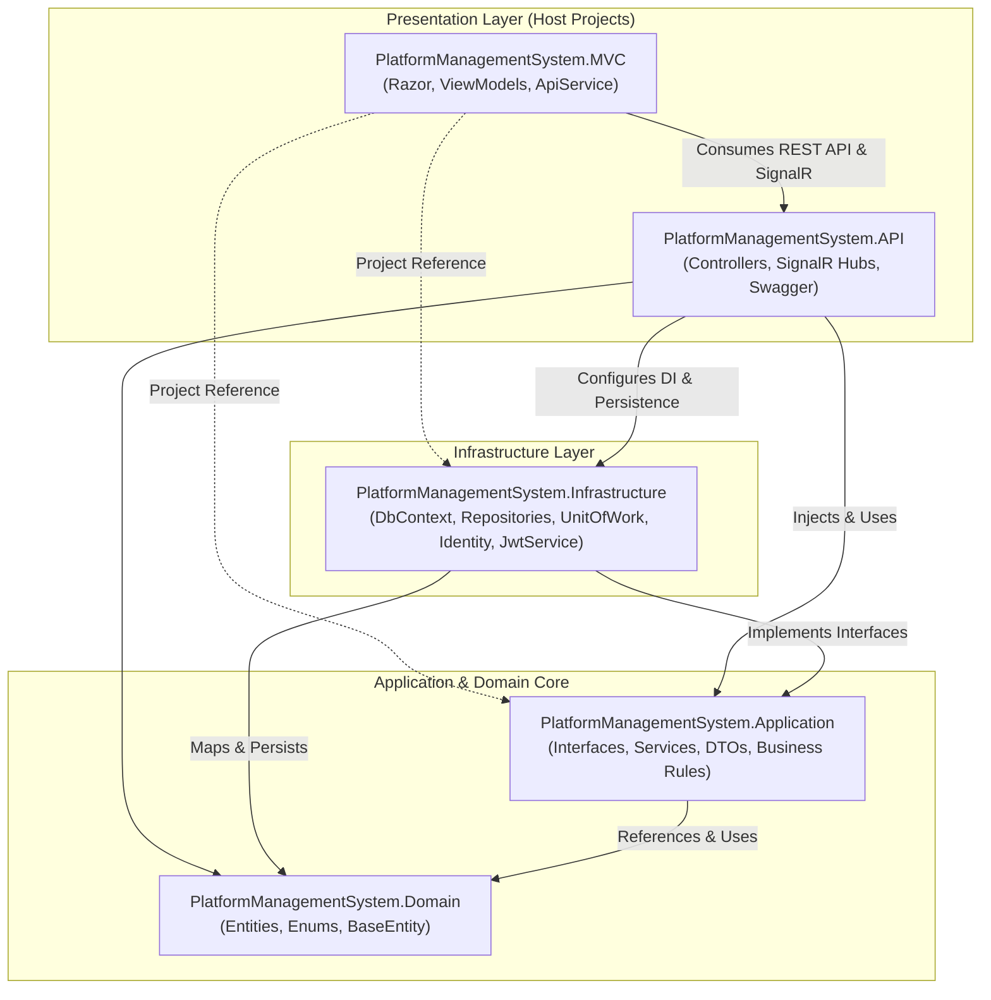
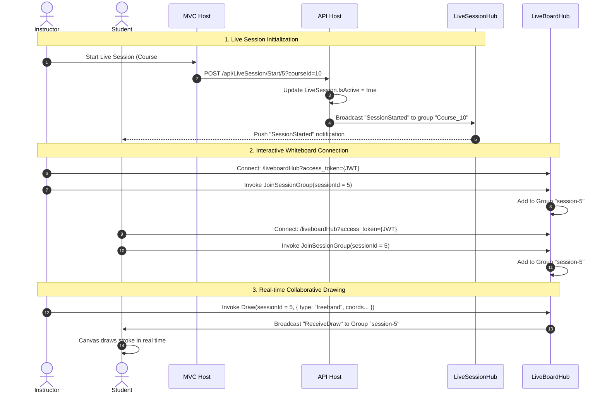
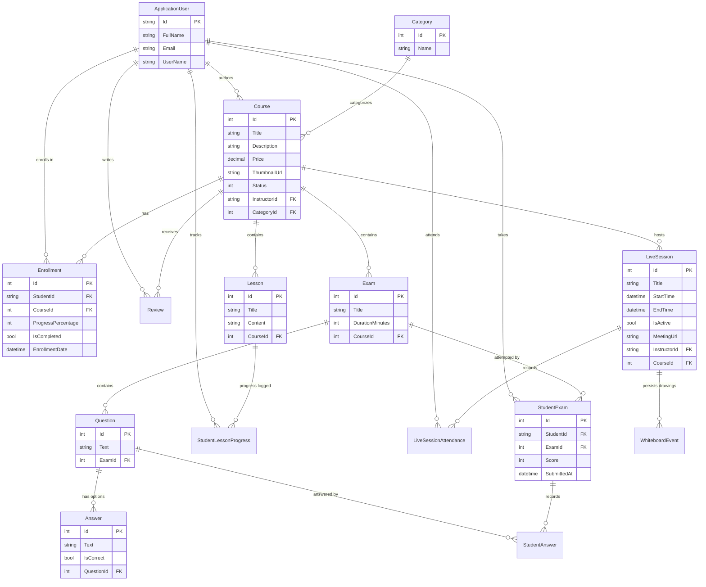

# System Architecture & Technical Design

This document details the architectural principles, software design patterns, component relationships, data flow, and database schema of **PlatformManagementSystem (PMS)**.

---

## 1. Architectural Style & Principles

PlatformManagementSystem follows **Clean / Onion Architecture**. The core domain logic is isolated from user interface concerns, frameworks, and database implementations.



### Key Architectural Tenets:
1. **Separation of Concerns**: Domain models and business logic are decoupled from database providers and HTTP transport protocols.
2. **Inversion of Control (IoC)**: Application services rely on abstractions (`IUnitOfWork`, `IGenericRepository<T>`, `IJwtService`, `IEnrollmentService`) whose concrete implementations reside in the Infrastructure layer.
3. **Decoupled Frontend & Backend**: The MVC application acts as an HTTP client to the Web API via `IApiService` and `IHttpClientFactory`, maintaining clear separation of client presentation and server logic.
4. **Real-time Event Broadcasting**: SignalR provides a persistent bidirectional communication channel for whiteboard synchronization and live classroom notifications.

---

## 2. Project Layers & Responsibilities

### 2.1 PlatformManagementSystem.Domain
The innermost layer. It has zero external dependencies outside of standard .NET runtime and core Identity primitives.

- **`Common/BaseEntity.cs`**: Abstract base model providing standard audit fields:
  - `Id` (integer primary key)
  - `CreatedAt` (`DateTime`, defaults to UTC now)
  - `UpdatedAt` (`DateTime?`, nullable)
- **`Entities/`**:
  - `ApplicationUser`: Extends `IdentityUser` with `FullName` and navigation collections (`Courses`, `Enrollments`).
  - `Course`: Core entity containing `Title`, `Description`, `Price`, `ThumbnailUrl`, `Status` (`CourseStatus`), `InstructorId`, `CategoryId`, and collections for `Lessons`, `Exams`, `Enrollments`.
  - `Category`: Categorization lookup entity (`Id`, `Name`, collection of `Courses`).
  - `Lesson`: Learning module belonging to a `Course` (`Title`, `Content`, `CourseId`).
  - `Enrollment`: Many-to-many relationship linking `StudentId` and `CourseId`, with `ProgressPercentage`, `IsCompleted`, and `EnrollmentDate`.
  - `StudentLessonProgress`: Tracks individual lesson completion states for students.
  - `Exam`: Assessment entity belonging to a `Course` (`Title`, `DurationMinutes`, `CourseId`, `Questions`).
  - `Question`: Multiple-choice question belonging to an `Exam`.
  - `Answer`: Option choice belonging to a `Question` (`Text`, `IsCorrect`).
  - `StudentExam`: Record of an exam submission (`StudentId`, `ExamId`, `Score`, `SubmittedAt`).
  - `StudentAnswer`: Recorded answer choice selected by a student for a specific question.
  - `LiveSession`: Virtual meeting session (`Title`, `StartTime`, `EndTime`, `MeetingUrl`, `IsActive`, `InstructorId`, `CourseId`).
  - `LiveSessionAttendance`: Attendance tracking for students joining a `LiveSession`.
  - `WhiteboardEvent`: Persistent whiteboard drawing action log associated with a `LiveSession`.
  - `WhiteboardElement`: Whiteboard canvas element state representation.
  - `RaiseHand`: Real-time student question queue entry.
  - `Review`: Student rating and feedback entry for a course.
- **`Enums/`**:
  - `RoleType`: `Admin = 1`, `Instructor = 2`, `Student = 3`.
  - `CourseStatus`: `Draft = 0`, `Pending = 1`, `Approved = 2`, `Rejected = 3`.

---

### 2.2 PlatformManagementSystem.Application
Contains use cases, business interfaces, data transfer contracts, and application service logic.

- **Contracts & Interfaces**:
  - `IGenericRepository<T>`: Standard repository contract for CRUD operations, filtering (`FindAsync`), and existence checks.
  - `IUnitOfWork`: Coordinates multiple repositories across a single database transaction.
  - Service contracts: `IAuthService`, `ICourseService`, `IEnrollmentService`, `IExamService`, `ILiveSessionService`, `ICategoryService`, `IDashboardService`, `IJwtService`.
- **DTOs**:
  - `LoginDto`, `RegisterDto`, `LoginResponseDto`
  - `CourseDto`, `CreateCourseDto`
  - `ExamDto`
  - `EnrollmentDto`
  - `LiveSessionDto`
  - `AdminDashboardDto`, `InstructorDashboardDto`, `StudentDashboardDto`
- **Application Services**:
  - Encapsulate business validation and interact with domain entities through `IUnitOfWork`.

---

### 2.3 PlatformManagementSystem.Infrastructure
Provides external resources, data persistence, and identity integration.

- **`Persistence/ApplicationDbContext.cs`**:
  - Inherits from `IdentityDbContext<ApplicationUser>`.
  - Configures EF Core fluent mappings:
    - Decimal precision (`Price` -> `decimal(18, 2)`).
    - Composite unique indexes (`Enrollment: {StudentId, CourseId}`, `StudentLessonProgress: {StudentId, LessonId}`).
    - Cascade and restrict delete behaviors (e.g., cascade delete for lessons and exams when a course is deleted, restrict delete on enrollments).
- **`Repositories/`**:
  - `GenericRepository<T>`: Implements generic LINQ queries against EF Core `DbSet<T>`.
  - `UnitOfWork`: Implements `IUnitOfWork`, exposing strongly-typed repository accessors for all entities and delegating `SaveChangesAsync()`.
- **`Identity/IdentitySeeder.cs`**:
  - Automated seeding invoked during API application initialization.
  - Ensures default `Student` and `Instructor` roles exist and seeds default `admin@test.com` account.
- **`Services/JwtService.cs`**:
  - Issues signed JWT security tokens containing user ID, email, and role claims using HMAC-SHA256.

---

### 2.4 PlatformManagementSystem.API
The primary HTTP and WebSocket entry point.

- **Controllers**:
  - Expose versioned REST endpoints configured with ASP.NET Core `[ApiController]` attributes.
  - Role-based authorization policies (`[Authorize(Roles = "Admin")]`, `[Authorize(Roles = "Instructor")]`, `[Authorize(Roles = "Student")]`).
- **Real-Time SignalR Hubs**:
  - `LiveBoardHub` (`/liveboardHub`): Interactive multi-user drawing synchronization.
  - `LiveSessionHub` (`/liveSessionHub`): Live session start/stop notifications.
- **Middleware Pipeline**:
  - CORS policy allowing requests from the MVC client origins with credentials.
  - Authentication middleware configured for JWT Bearer tokens with custom query string handling for WebSockets.
  - Swagger UI documentation.

---

### 2.5 PlatformManagementSystem.MVC
The server-rendered user interface.

- **Dual-Model Authentication**:
  - Cookie Authentication stores user claims in an encrypted cookie (`CookieAuthenticationDefaults`).
  - In-memory Session stores the JWT string (`UserToken`) and user metadata.
- **API Communication**:
  - Outgoing HTTP calls use a named `HttpClient` ("API") configured with `JwtHandler`.
  - `JwtHandler` (`DelegatingHandler`) extracts the JWT from the current `HttpContext.Session` and appends `Authorization: Bearer <token>` automatically.
- **Action Filters**:
  - `AuthorizeSessionAttribute`: Redirects unauthenticated requests to `/Account/Login`.
  - `BaseController`: Automatically unpacks the JWT from session and populates `ViewBag.UserRole`.

---

## 3. Real-Time SignalR Architecture

PlatformManagementSystem features an interactive live classroom and whiteboard engine powered by SignalR.



### SignalR Hub Endpoints:
1. **`/liveboardHub`**:
   - Manages interactive drawing events (`dot`, `freehand`, `rectangle`, `circle`, `line`, `arrow`, `text`, `clear`).
   - Group partition: `session-{sessionId}`.
   - Message broadcasting: `SendMessage(sessionId, message)` delivers real-time group chat.
2. **`/liveSessionHub`**:
   - Group partition: `Course_{courseId}`.
   - Broadcasts real-time course alerts when live broadcasts start or conclude.

---

## 4. Authentication & Authorization Flow

```mermaid
sequenceDiagram
    autonumber
    actor User as User
    participant MVC as PlatformManagementSystem.MVC
    participant API as PlatformManagementSystem.API
    participant DB as SQL Server (LocalDB)

    User->>MVC: Submit Login Form (Email, Password)
    MVC->>API: POST /api/Auth/login
    API->>DB: Validate credentials via UserManager
    DB-->>API: User verified (Roles: [Instructor])
    API->>API: JwtService generates signed JWT Bearer Token
    API-->>MVC: Return { token, email, role, userId }
    MVC->>MVC: HttpContext.Session.SetString("UserToken", token)
    MVC->>MVC: Issue Authentication Cookie with ClaimsPrincipal
    MVC-->>User: Set-Cookie: .AspNetCore.Cookies; Redirect to /InstructorDashboard

    Note over User,DB: Subsequent Authenticated Operation
    User->>MVC: GET /InstructorDashboard/MyCourses
    MVC->>MVC: JwtHandler retrieves UserToken from Session
    MVC->>API: GET /api/Course/ByInstructor/{id} (Header: Bearer {token})
    API->>API: Validate JWT signature & role claims
    API->>DB: Query Courses via UnitOfWork
    DB-->>API: Courses result set
    API-->>MVC: Return Course JSON DTOs
    MVC-->>User: Render HTML Razor Page
```

---

## 5. Database Schema & Entity Relationships

The relational model is managed via Entity Framework Core Code-First migrations against SQL Server.



---

## 6. Design Patterns Implemented

1. **Repository Pattern (`GenericRepository<T>`)**:
   Encapsulates data query operations, abstracting EF Core specifics from application services.
2. **Unit of Work Pattern (`UnitOfWork`)**:
   Maintains a list of repositories and shares a single `ApplicationDbContext` instance across services, ensuring transactional atomicity upon `SaveChangesAsync()`.
3. **Delegating Handler Pattern (`JwtHandler`)**:
   An HTTP message handler in the MVC client that intercepts outbound HTTP requests and automatically injects authentication headers from session data.
4. **Publish-Subscribe / Observer Pattern (SignalR Hubs)**:
   Enables instructors to publish events (`Draw`, `SessionStarted`) to subscribed client groups without point-to-point client coupling.
5. **Data Transfer Object (DTO) Pattern**:
   Isolates persistence entities from API wire representations, preventing over-posting vulnerabilities and cyclic JSON references.
