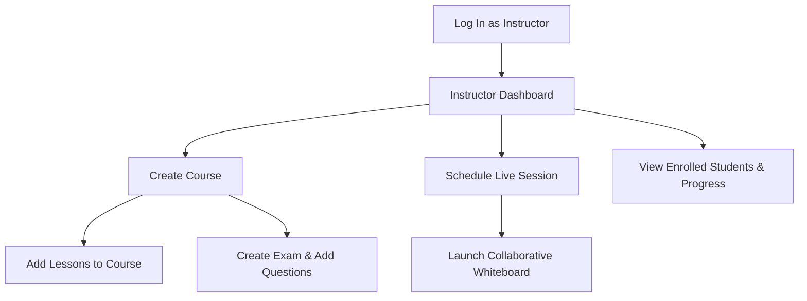
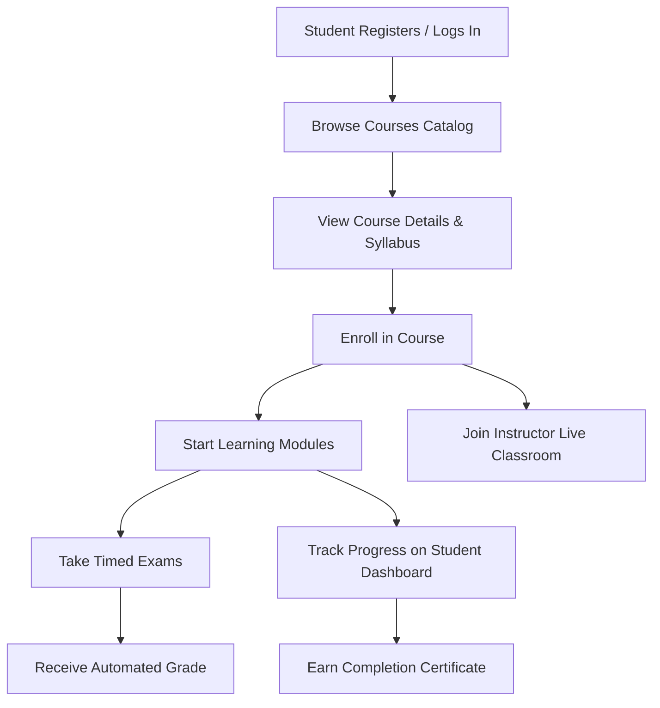
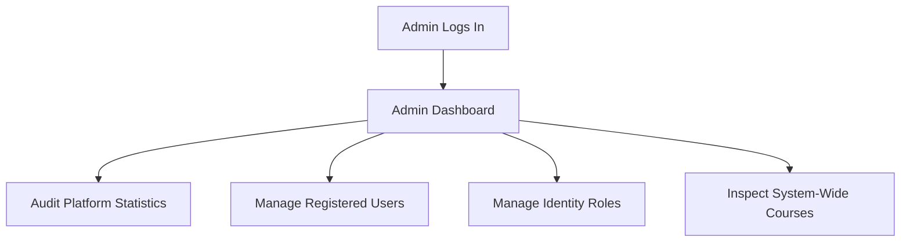

# Feature Walkthroughs & User Workflows

This document outlines the core business workflows and functional use cases supported by **PlatformManagementSystem (PMS)** for Instructors, Students, and Administrators.

---

## 1. Instructor Workflows

Instructors are the content creators and educators on the platform.

### 1.1 Course Creation & Authoring
1. **Access Course Creator**:
   - Navigate to `/InstructorDashboard` and select **Create Course** (`/InstructorDashboard/CreateCourse`).
2. **Submit Details**:
   - Enter **Title** (required, max 100 characters).
   - Enter **Description** (required).
   - Select the relevant **Category**.
   - Set the course **Price**.
3. **Course Status**:
   - Newly created courses receive an initial status of `CourseStatus.Pending` until approved by an administrator.

---

### 1.2 Curriculum & Lesson Sequencing
1. **Navigate to Course Lessons**:
   - Open `/InstructorDashboard/ManageCourse?courseId={id}`.
2. **Add Lessons**:
   - Click **Add Lesson** (`/Lessons/Create?courseId={id}`).
   - Provide the **Lesson Title** and rich text/markdown **Content**.
   - Lessons are indexed and sequenced automatically.
3. **Lesson Maintenance**:
   - Instructors can review lesson lists or delete outdated modules via `/Lessons/Delete/{id}`.

---

### 1.3 Exam Builder & Automated Assessments
1. **Create Assessment**:
   - In `/InstructorDashboard/ViewExams?courseId={id}`, select **Create Exam** (`/Exam/Create?courseId={id}`).
   - Define the **Exam Title** and **Duration in Minutes**.
2. **Add Multiple-Choice Questions**:
   - Once the exam is created, redirect to `/Exam/AddQuestion?examId={id}`.
   - Enter the **Question Text**.
   - Provide four answer choices and designate the **Correct Answer Index**.
3. **Question Pool Management**:
   - Review all questions under `/Exam/Questions?examId={id}`.
   - Edit questions and answer keys (`/Exam/EditQuestion?questionId={id}`).
   - Delete obsolete questions (`/Exam/DeleteQuestion`).

---

### 1.4 Hosting Live Classrooms & Collaborative Whiteboard
1. **Schedule a Live Session**:
   - Navigate to `/LiveSession/ByCourse?courseId={id}`.
   - Click **Create Live Session**, providing the **Title**, **Start Time**, and optional external meeting URL.
2. **Start the Session**:
   - Click **Start Session**. The server marks the session active and broadcasts a `SessionStarted` notification to all enrolled students via `LiveSessionHub`.
3. **Interactive Whiteboard (`/LiveSession/Board`)**:
   - Loads the HTML5 canvas whiteboard powered by `whiteboard.js` and `/liveboardHub`.
   - **Supported Tools**:
     - **Freehand Pen**: Smooth stroke drawing.
     - **Geometric Primitives**: Rectangles, Circles, Straight Lines, Directional Arrows.
     - **Text Annotations**: Interactive prompts to place text labels on the canvas.
     - **Color Picker**: Dynamic color selection applied to all strokes.
     - **Canvas Controls**: Full **Undo** stack, **Redo** stack, **Clear Board**, and **Save Image** (PNG export).
   - All drawing actions broadcast in real time to connected students via `connection.invoke("Draw", sessionId, drawData)`.

---

## 2. Student Workflows

Students consume learning material, take exams, and participate in live sessions.

### 2.1 Course Discovery & Enrollment
1. **Browse Catalog**:
   - Navigate to the public course catalog at `/Courses`.
   - Filter by categories or inspect course summaries.
2. **Inspect Syllabus**:
   - Click **Details** (`/Courses/Details/{id}`) to view the instructor biography, total enrolled students, price, and syllabus outline.
3. **Enrollment**:
   - Click **Enroll Now**.
   - An authenticated student is registered in `Enrollment` with initial progress set to `0%`.

---

### 2.2 Learning Portal & Progress Tracking
1. **Access Enrolled Content**:
   - From `/StudentDashboard`, click on an enrolled course to navigate to `/StudentDashboard/CourseDetails/{courseId}`.
2. **Complete Lessons**:
   - View lesson content sequentially.
   - Marking lessons completed updates `StudentLessonProgress` and recalculates the overall course progress percentage.
3. **Visual Analytics**:
   - `/StudentDashboard/ProgressChart`: Renders visual completion graphs per course.
   - `/StudentDashboard/CompletionChart`: Visualizes completed vs. pending courses.

---

### 2.3 Taking Exams & Receiving Instant Results
1. **Access Exam**:
   - Navigate to the course exam link (`/Exam/Solve?examId={id}`).
2. **Answer Questions**:
   - The interface presents the question pool with selectable options.
   - A single attempt is permitted per student per exam (`StudentExams` prevents duplicate submissions).
3. **Submission & Grading**:
   - When the student clicks **Submit Exam**, answers are submitted to `POST /api/Exam/{id}/submit`.
   - The backend validates each answer against the answer key, records the final score in `StudentExam`, updates progress, and displays the results page (`/Exam/Result`).

---

### 2.4 Certification
- Upon reaching 100% course completion, students can access `/StudentDashboard/Certificate/{courseId}`.
- Displays a certificate of completion noting the student's name, course title, and completion date.

---

## 3. Administrator Workflows

Administrators oversee the platform, maintain user accounts, and govern system roles.

### 3.1 Platform Health & Auditing
- Navigate to `/AdminDashboard`.
- Inspect aggregated counts:
  - **Total Registered Users**
  - **Total Active Courses**
  - **Total Enrollments**
  - **Total Exams Conducted**

---

### 3.2 User Governance
- Navigate to `/AdminDashboard/Users` (`GET /api/Admin/Users`).
- Inspect all registered accounts, their associated email addresses, and their current Identity roles.
- Remove deactivated or non-compliant users via `DeleteUser(id)`.

---

### 3.3 Role-Based Access Control (RBAC)
Administrators manage system privileges through `/api/Admin` endpoints:
- **List Roles**: `GET /api/Admin/Roles`
- **Create Role**: `POST /api/Admin/CreateRole` (`{"roleName": "TeachingAssistant"}`)
- **Assign Role to User**: `POST /api/Admin/AssignRole` (`{"userId": "...", "roleName": "Admin"}`)
- **Revoke Role**: `POST /api/Admin/RemoveRole` (`{"userId": "...", "roleName": "..."}`)

---

### 3.4 Catalog & Course Governance
- Access `/AdminDashboard/Courses` (`GET /api/Admin/Courses`).
- View all published courses along with student enrollment numbers across the platform.
- Manage categories via `POST /api/Category` to organize future course submissions.
